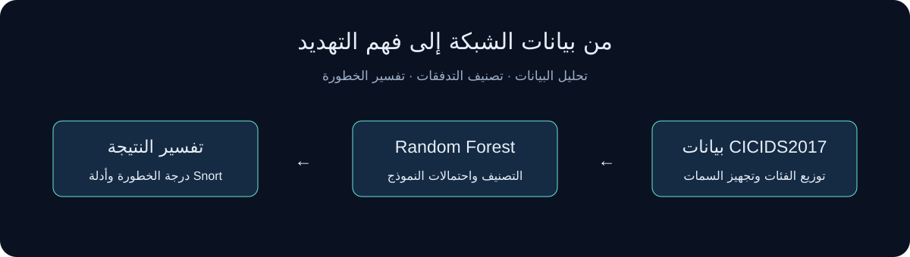
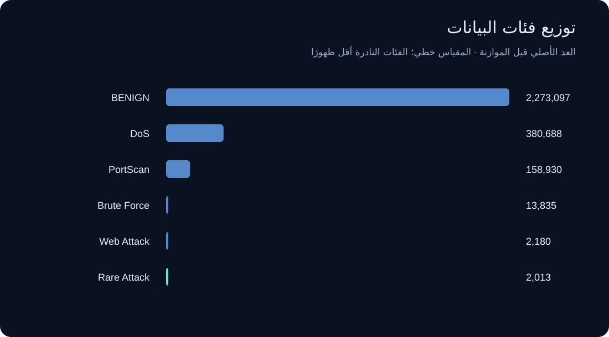
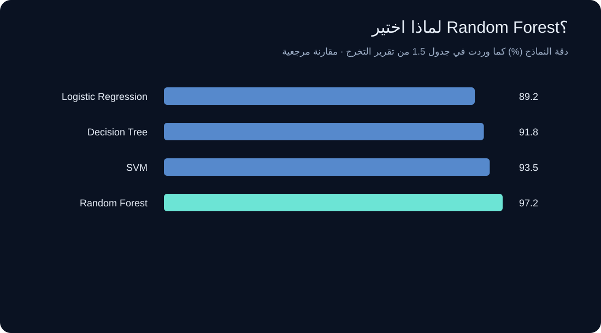
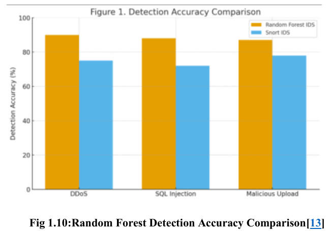
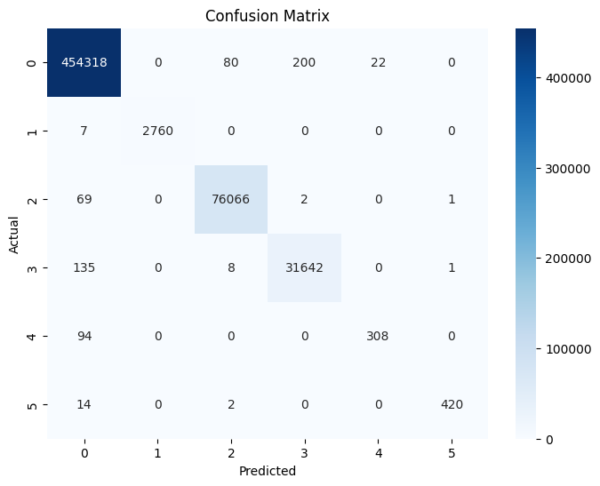
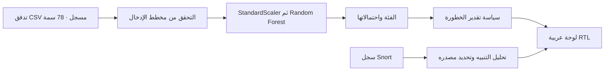
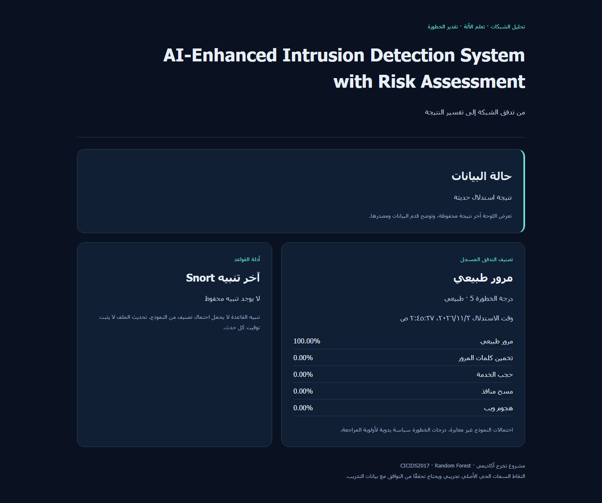

<div dir="rtl" lang="ar">

# AI-Enhanced Intrusion Detection System with Risk Assessment

**تحليل تدفقات الشبكة، وتصنيف الهجمات بالتعلم الآلي، وتفسير أولويات المراجعة الأمنية.**

مشروع تخرج في هندسة الحاسب يجمع تحليل بيانات CICIDS2017 ونموذج Random Forest وأدلة Snort ولوحة Flask. يعرض المستودع رحلة البيانات وقرار اختيار النموذج ونتائج التجربة التاريخية، مع تطبيق محلي لاستدلال التدفقات المسجلة.



[التشغيل](#التشغيل-المحلي) · [بطاقة النموذج](docs/model-card.md) · [مصادر الأشكال](docs/figures.md) · [التحقق والحدود](docs/validation.md)

## التقرير والعرض وملفات التخرج

| المادة الأصلية | الوصول |
|---|---|
| التقرير الأكاديمي الكامل، 56 صفحة | [قراءة التقرير PDF](docs/reports/graduation-report.pdf) |
| العرض النهائي، 24 شريحة | [فتح البرزنتيشن PDF](docs/reports/final-presentation.pdf) |
| ملخص المشروع، صفحة واحدة | [قراءة الملخص PDF](docs/reports/project-overview.pdf) |
| دفتر التدريب ونتائجه المحفوظة | [فتح Notebook](notebooks/multiclass-training.ipynb) |

ملفات PDF نسخ مطابقة للملفات الأصلية التي قدمها الفريق، مع توثيق بصماتها في `docs/reports/manifest.json`. تحتوي على الأسماء والبيانات الأكاديمية الأصلية. تُقرأ ادعاءات النتائج التاريخية مع بطاقة النموذج التي توضح اختلاف نسخ التدريب والتشغيل.

## البيانات أولًا

جرد الملفات الثمانية أعطى **2,830,743 سجلًا** و**78 سمة** و15 تسمية أصلية. الدفتر يوحّد الهجمات في ست مجموعات. هذا التوزيع يفسر ضرورة النظر إلى الاستدعاء لكل فئة وmacro-F1 إلى جانب الدقة الإجمالية.



التجهيز في الدفتر يشمل توحيد أسماء الأعمدة والتسميات، فصل الهدف، تقسيمًا طبقيًا 80/20 ببذرة 42، استبدال القيم غير المنتهية، ثم تعلم StandardScaler على قسم التدريب. يستخدم Random Forest مئة شجرة. فحص التكرار بين الأقسام والتحقق الزمني مطلوبان قبل تعميم النتائج على شبكة جديدة.

## لماذا Random Forest؟

اختار الفريق Random Forest استنادًا إلى المقارنة الواردة في **جدول 1.5 من تقرير التخرج**. يظهر الرسم إعادة عرض أرقام الجدول مع تمييز مصدرها المرجعي. تتصدر الخوارزمية النماذج الأربعة في المقارنة المذكورة بدقة 97.20% وF1 تساوي 96.70%.



الأرقام من الجدول المنسوب في التقرير إلى المرجع [8]، وليست تجربة مقارنة أُعيد تنفيذها هنا. تتضمن صفحة مصادر الأشكال تفاصيل الإسناد وحدود التحقق من الدراسة الأصلية.

<details><summary>الشكل الأصلي 1.10 من التقرير — مقارنة مرجعية مع Snort</summary>



مقتطف من الصفحة المطبوعة 21، والمنسوب داخل التقرير إلى المرجع [13]. يمثل سياق الدراسات السابقة لا قياسًا جديدًا لهذه النسخة. المصدر الكامل في التقرير المرفق.

</details>

## ماذا أظهرت تجربتنا؟

الدفتر يحفظ تقرير اختبار لـ**566,149 عينة** بست فئات. accuracy تظهر `1.00` عند تقريب العرض إلى منزلتين، وmacro-F1 تساوي `0.97`. الفئة النادرة حققت recall قدره `0.77` مع 402 عينة اختبار، بينما حققت هجمات الويب recall قدره `0.96` مع 436 عينة. هذه مخرجات تاريخية محفوظة.



ترتيب محوري المصفوفة من 0 إلى 5 هو BENIGN، Brute Force، DoS، PortScan، Rare Attack، Web Attack. أُخرجت الصورة الأصلية من الدفتر دون إعادة توليد قيمها. [تفاصيل المقاييس والفروق بين النسخ](docs/model-card.md).

## من التحليل إلى التطبيق

</div>



<div dir="rtl" lang="ar">

توضح اللوحة وقت الاستدلال وحداثته ومصدر التنبيه. تعرض حالة غياب البيانات أو تلفها صراحة. درجة الخطورة سياسة يدوية بقيم 5 و25 و50 و75 و95، واحتمالات Random Forest غير مثبتة المعايرة. مسار الالتقاط الحي التاريخي محفوظ للبحث ويحتاج مطابقة سماته مع بيانات التدريب.



لقطة من استدلال أول سجل حقيقي في ملف يوم الاثنين. نسبة الاحتمال الظاهرة تخص هذا السجل فقط، ولا تمثل دقة النموذج الإجمالية.

## التشغيل المحلي

استخدم Python 3.12، ثم نفذ الأوامر من جذر المستودع.

</div>

```powershell
python -m venv .venv
.venv\Scripts\python -m pip install -r requirements.txt
.venv\Scripts\python app.py
```

<div dir="rtl" lang="ar">

افتح `http://127.0.0.1:5000`. تعمل اللوحة دون أوزان وتعرض حالة توفر البيانات الفعلية. على Linux استخدم `.venv/bin/python` بدل مسار Windows.

للاستدلال، ضع النسخة الموثوقة من الملفات `model_multiclass.pkl` و`scaler.pkl` و`label_encoder.pkl` و`feature_columns.json` داخل `artifacts/` محليًا. ثم مرّر CSV يحمل السمات الـ78 بالترتيب الذي يحدده المخطط. يرفض التطبيق القيم غير المنتهية والسمات الناقصة.

إذا كان أرشيف مشروع التخرج الأصلي متاحًا لديك، يستورد `python import_artifacts.py "path/to/ids_project (2).zip"` الملفات الأربعة فقط، ويحتفظ ببصماتها محليًا. الأوزان والبيانات الكبيرة محفوظة خارج Git.

</div>

```powershell
.venv\Scripts\python predict.py data/sample.csv --row 0
.venv\Scripts\python -m pytest -q
```

<div dir="rtl" lang="ar">

لقراءة Snort، وجّه أو انسخ سجل `alert_fast.txt` إلى `runtime/alert_fast.txt`. يمكن ضبط `IDS_RUNTIME` لاختيار مجلد تشغيل آخر. دليل Pi وتفاصيل الاستخدام في [دليل التشغيل](docs/setup.md).

## تنظيم المشروع

| المسار | المحتوى |
|---|---|
| `app.py`، `templates/`، `static/` | لوحة المراقبة وواجهات الصحة والحالة |
| `inference.py`، `predict.py` | عقد السمات وتحميل الأوزان واستدلال CSV |
| `notebooks/` | دفتر التدريب ومخرجاته التاريخية |
| `docs/` | منهجية البيانات، بطاقة النموذج، الأشكال ومصادرها، التحقق |
| `tests/` | اختبارات الحالات الفارغة والقديمة والتالفة وتنبيهات القواعد |
| `archive/original-source/` | المصادر الأصلية للرجوع، بما فيها التجارب الحية |
| `artifacts/`، `data/`، `runtime/` | ملفات محلية مستثناة من Git |

## الفريق

خالد نوح الغانمي، ريان سعيد القحطاني، عبدالرحمن سعيد الأسمري، محمد علي الحمّود، ومحمد بن يحيى العسيري. الإشراف الأكاديمي للدكتور عمر السر الطيفور، قسم هندسة الحاسب، جامعة الملك خالد. أسماء الفريق مستندة إلى التقرير الأصلي، وتوزيع المسؤوليات الفردية غير موثق في هذه النسخة.

## حدود النسخة

الدفتر يمثل تجربة بست فئات، بينما مرمّز الأوزان المحفوظة يمثل خمسًا وملف البيانات المجهز يحتوي مليون صف متوازن. يجب الحفاظ على هذا الاختلاف عند تفسير المقاييس. لا توجد إعادة تقييم مستقلة منشورة للأوزان الخماسية. استخدام المشروع أكاديمي، وأداء التقاط الشبكة الحي وRaspberry Pi لم يُقاس ضمن تجهيز المستودع.

حقوق الكود والمواد تعود إلى أصحابها. لم يُحدد ترخيص إعادة توزيع مفتوح للمواد الجماعية. راجع [مصادر الأشكال](docs/figures.md) قبل إعادة استخدامها.

</div>
